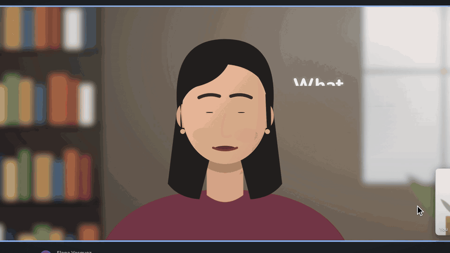

<p align="center">
  <b>English</b> ·
  <a href="docs/i18n/README.zh-CN.md">简体中文</a> ·
  <a href="docs/i18n/README.ja.md">日本語</a> ·
  <a href="docs/i18n/README.ko.md">한국어</a> ·
  <a href="docs/i18n/README.es.md">Español</a> ·
  <a href="docs/i18n/README.pt-BR.md">Português (Brasil)</a> ·
  <a href="docs/i18n/README.de.md">Deutsch</a> ·
  <a href="docs/i18n/README.fr.md">Français</a> ·
  <a href="docs/i18n/README.hi.md">हिन्दी</a>
</p>

# Lumi: the light inside your Mac

**Ask, and Lumi finds it in the dark, does the work, and shows you the answer.**

Ask a question from any app, and Lumi finds the right file, works through it and checks the tools you've connected, like Slack, Drive, Notion or GitHub. Instead of a wall of text, you get only what needs your attention, right where you're looking. Powered by your Claude Code. Free, open source and local.

<p>
  <a href="https://github.com/loomtable/lumi/releases/latest"></a>
  <a href="#requirements"></a>
  <a href="LICENSE"></a>
</p>

[Download](https://github.com/loomtable/lumi/releases/latest) · [Install](#install) · [What Lumi reads](#what-lumi-reads) · [FAQ](#faq) · [Website](https://lumi.loomtable.com)

<p align="center">
  <a href="https://lumi.loomtable.com">
    
  </a>
</p>

**Install:**

```sh
curl -fsSL https://lumi.loomtable.com/install.sh | sh
```

**Requires:** macOS 26 on Apple Silicon, and Claude Code 2.1.312 or newer, signed in. Other ways: [Install](#install).

Star the repo to follow what ships next.

## You ask. Lumi takes it from there.

| | |
| --- | --- |
| **On your screen, listens to you.** | Tap the Lumi key (right ⌥ by default) and ask. Lumi reads the front window, your selection and what the app is showing, only at that moment. |
| **Finds and works with your files.** | It searches Documents, Downloads and Desktop and opens the right file at the right page, cell or slide. |
| **Works on your Mac.** | It reads sheets and PDFs, compares two files, runs a quick breakdown on a CSV, runs tests and proposes edits. Changes it proposes wait for your OK. |
| **Integrates with your tools.** | Slack, Notion, Linear, GitHub, Jira, Drive, Calendar, a browser: whichever you've connected. |
| **Free, local and open source.** | No account, no servers of ours, no analytics. Speech-to-text and the default voice run on your Mac. |

Questions start in **Quick**, on a fast model. When a question needs files, commands or the browser, Lumi hands it to **Deep**, your full Claude Code, in the same session, and tells you. Start with "go deep" to go straight to Deep, or with "research" for a long background job.

## Answers built for you

One line, a picture when it helps, and a ring on the exact spot. No wall of text: Lumi points at the answer.

- **One spoken line** that is the answer.
- **A card when a picture helps:** up to 5 bullets, a table of up to 5 rows, one labelled diagram, or a set of images, right next to what you were looking at.
- **Rings** on the exact cell, clause, name or button.
- **Insert** puts the text into the field you're writing in. It never sends.

Ask once and you've got the hang of it.

## Every question keeps its thread

Each thing you ask becomes a session. A follow-up from another app picks up where you left off, and the history survives a relaunch.

- **Hold the Lumi key and press Tab** to switch. Your recent sessions open under the listening pill; speak before you let go, and the words go to the one you picked. N starts a new one.
- **Type, and it opens in the Panel.** Double-tap the key: the answer streams in beside your work, code blocks and all, as your full Claude Code with your skills, slash commands and MCP servers. Paste or drop images and files, type `@` for a file or `/` for a command, and edit an earlier question to take the conversation from there.
- **Long work keeps going.** Each running question gets a small capsule at the top of the screen. A finished answer waits its turn instead of covering the one you're reading, and anything that needs your OK turns amber and opens with one click.
- **Teammates.** A big job can split across background helpers, 3 at most by default, each in its own lane. Lumi proposes the split first and waits for your yes; Settings › Teammates changes that.
- **The Lumi window** holds every session, Home and Settings, and opens from the Dock. Search with ⌘K, start fresh with ⌘N. Pick a theme in Settings › Appearance.
- **Dictation key.** Tap it, speak, tap again: the words are typed at your cursor in any app, and nothing goes to Claude. Holding works too. Every dictation is saved to your Dictation history in the Lumi window and kept as long as your sessions (Settings › Privacy › Keep sessions for). One refused by a password field is never saved. Lumi picks fn or right ⌘ for you; change it in Settings › General.

## Built for the work you do

Founders, designers, analysts, writers, students, developers and everyone in between.

| You | The moment | What Lumi does |
| --- | --- | --- |
| **Founders** | An investor on a call asks for last month's burn. | Finds the board deck and model in Documents, opens the sheet, checks Drive's latest export, rings the figure and its source, and inserts it into your meeting notes. |
| **Designers** | "Does this screen match our spacing tokens?" | Finds the tokens file, compares the values, reads the design-system page in Notion, and shows a table of mismatches with a ring on each one. |
| **Analysts** | "Why did sign-ups drop on Tuesday?" | Finds the CSV export in Downloads, runs a quick breakdown, checks the sheet in Drive, and gives one spoken line with the cause, a small table and a ring on the dip. |
| **Writers** | "Where did I get that statistic?" | Finds the sources folder, opens the source at the right page, rings the sentence, and inserts the citation. |

<details>
<summary><b>More moments:</b> product managers, researchers, marketers, sales, students, consultants, operators, developers</summary>
<br>

| You | The moment | What Lumi does |
| --- | --- | --- |
| **Product managers** | Tagged in a 214-reply Slack thread before standup. | Reads the thread, finds launch-plan.md, confirms the decision in Notion, and gives a decided / open / owner card with a reply ready to insert. |
| **Researchers** | "How does this method differ from the one in my notes?" | Opens your notes and the earlier paper at the method sections, checks the Drive copy, and gives a side-by-side table. |
| **Marketers** | "Make this sound like our brand." | Reads the brand guide, the last campaign and the content calendar in Notion, and inserts the rewrite into your draft. It never sends. |
| **Sales** | Two minutes before a call: "What did we promise this account?" | Opens the proposal PDF at the pricing section, reads the call notes, and gives three bullets with a ring on the contact's name. |
| **Students** | Studying a lecture slide: "Explain this step." | Finds the lecture notes and the reading, works through the equation, and gives a one-diagram card with a short spoken answer. |
| **Consultants** | A client asks about a clause in the March contract. | Finds the contract in Downloads, opens the PDF at §9.2, confirms the Drive copy matches, and has the reply ready to insert. |
| **Operators** | A vendor invoice doesn't match the PO. | Reconciles the PO and the delivery note in a sheet, reads the vendor thread in Slack, and shows the three mismatched lines with a reply to insert. |
| **Developers** | Checkout errors at 2am. | Finds the service in the repo and the failing test, and proposes a diff that waits for your OK. Once the tests go green, a draft PR for GitHub is ready for your OK. |

</details>

Slack, Notion, GitHub and Drive steps run through the tools you've connected. Got an ask that works for your job? Write it up as a [recipe](recipes/).

## Why Lumi

Others answer. Lumi gets it done.

| Usually | With Lumi |
| --- | --- |
| You paste screenshots and explain where you are. | Lumi sees the front window and finds the files that matter. |
| It tells you how. | Lumi uses the right tool and does it. Changes it proposes wait for your OK. |
| Another account, another cloud, another memory. | Lumi runs on your Mac with your own setup, and no servers of ours. |
| It watches your screen all day. | Lumi looks only when you press the key. |

## Install

Check the [requirements](#requirements) first.

**Option 1: Terminal (one line, no warning).**

```sh
curl -fsSL https://lumi.loomtable.com/install.sh | sh
```

It downloads `Lumi.zip` from the [latest release](https://github.com/loomtable/lumi/releases/latest), checks its SHA-256 and signature, and puts Lumi in Applications. It never opens Lumi, and asks for your password only if your account can't write to Applications. [Read the script first](https://lumi.loomtable.com/install.sh). Then open Lumi from Applications.

**Option 2: Ask Claude Code.** Paste this into Claude Code:

```text
Install Lumi for me. First read https://lumi.loomtable.com/install.sh and tell me in two lines what it does. Then run: curl -fsSL https://lumi.loomtable.com/install.sh | sh
When it finishes, open Lumi with: open -a Lumi
```

**Option 3: Download.**

1. Get [`Lumi.zip`](https://github.com/loomtable/lumi/releases/latest/download/Lumi.zip), open it and move Lumi to Applications.
2. Lumi isn't signed with an Apple Developer ID yet, so macOS stops the first launch. Open Lumi and close the warning. Right after you try to open it, go to **System Settings › Privacy & Security**, scroll down and click **Open Anyway** next to Lumi. When the warning appears again, click **Open** and confirm with your password or Touch ID. From then on, Lumi opens normally.

To check the download, get `Lumi.zip.sha256` from the same release and run `shasum -a 256 -c Lumi.zip.sha256` in that folder; it prints `OK`. Disk images (`.dmg`) are on the release too, but macOS stops them twice.

Onboarding then sets up the Lumi key, permissions and voice. Tap right ⌥ in any app and ask your first question.

<details>
<summary><b>Permissions Lumi asks for</b></summary>
<br>

| Permission | Required | Why |
| --- | --- | --- |
| Input Monitoring | Yes | To notice the Lumi key. Lumi never records what you type. |
| Accessibility | Yes | To read your selection, insert text and close cards with Esc. |
| Screen Recording | Yes | For the screenshot of the front window that goes with your question. |
| Microphone | No | To ask out loud. Without it, you can always type. |

macOS applies Input Monitoring and Screen Recording only after Lumi reopens; use the **Quit & Reopen** button next to each.

</details>

**Update:** run the Terminal line again; it quits Lumi and replaces it. Or choose **Check for Updates…** in Lumi's menu, download the new release and replace Lumi in Applications; if macOS stops the new copy, click **Open Anyway** again. Your settings, conversations and permissions stay either way.

<a id="what-it-sees-and-sends"></a>

## What Lumi reads

Lumi looks only when you press the key. Between key presses it reads nothing.

**When you ask, it reads:**
- the app and window in front;
- your selected text, the element under the pointer and whether the focused field is editable;
- what the front app is showing, where Lumi can tell: a terminal's folder and command, a local dev server's port and folder, an editor's project and file, a chat's channel and thread, a Finder folder and its selection;
- which apps you used recently, and your displays' layout;
- a screenshot of the front window, or of the display.

**It skips** password managers and apps you block in Settings › Privacy; their windows are left out of screenshots. It never reads the text in password fields, though a field's dots can show up in a screenshot. Secrets in command lines and addresses, such as tokens and keys, are removed before anything is sent.

**What goes where:** your question, this context and the screenshot go to your AI harness on your Mac (see [Requirements](#requirements)), which sends them to Anthropic to answer, under your Claude account. Lumi itself has no servers, no account and no analytics.

**What stays on your Mac:** speech-to-text and every voice except ElevenLabs run on your Mac, and your voice recording never leaves it. Screenshots are kept for 24 hours at most; Settings › Privacy can shorten that to 6 hours or 1 hour. The trace log is off by default; when on, it records timings, event types and outcomes, never what you said or saw, and keeps 7 days.

<details>
<summary><b>The only times Lumi itself goes online</b></summary>
<br>

- When you turn voice on, it downloads a small silence detector from Hugging Face (about 1 MB, once).
- Only if you choose them, in onboarding or Settings › Voice, it downloads Parakeet speech-to-text (about 466 MB) or the Kokoro voice (about 437 MB) from Hugging Face, once each.
- If you turn on ElevenLabs voice, your ElevenLabs key is used to list your voices, and the reply text goes to ElevenLabs to be spoken.

By default Lumi listens and speaks with the Mac's own speech recognition and voice, so there's nothing big to download; macOS may add its English speech files the first time. MCP servers you add in Settings › Connections run inside your harness and talk to their own services, like any other MCP server.

</details>

## FAQ

<details>
<summary><b>What is Lumi?</b></summary>

A free, open-source Mac menu-bar app by Loomtable. Tap a key in any app and ask out loud or type. Lumi answers with what's on your screen in view: one spoken line, a card when a picture helps and a ring on the exact spot.
</details>

<details>
<summary><b>Is Lumi free? What do I need?</b></summary>

Lumi is free and open source under GPL-3.0-or-later. You need a Mac on macOS 26 with Apple Silicon and the harness Lumi works with, installed and signed in; questions count against your own Claude plan or API usage. See [Requirements](#requirements).
</details>

<details>
<summary><b>Who is it for?</b></summary>

Anyone who works on a Mac: founders, product managers, designers, researchers, analysts, marketers, sales, writers, students, consultants, operators and developers. See [Built for the work you do](#built-for-the-work-you-do).
</details>

<details>
<summary><b>Which apps and tools does Lumi work with?</b></summary>

You can ask from any app on your Mac. Lumi works with the tools you've connected through MCP in your own setup, such as Slack, Notion, Linear, GitHub, Jira, Drive, Calendar and a browser, along with your own login, CLAUDE.md and skills.
</details>

<details>
<summary><b>Does Lumi watch my screen all the time?</b></summary>

No. It looks only when you press the Lumi key, and it skips password managers and apps you block. See [What Lumi reads](#what-lumi-reads).
</details>

<details>
<summary><b>Can I use it without talking?</b></summary>

Yes. Double-tap the Lumi key to type; the answer opens in the Panel. The microphone permission is optional.
</details>

<details>
<summary><b>Can I turn a new feature off?</b></summary>

Yes. Settings › Teammates › Off stops teammates, and the dictation key has its own setting. For the rest, run `defaults write com.loomtable.lumi v2.<name> -bool NO` in Terminal and reopen Lumi, where `<name>` is `switcher`, `panel`, `permissionHost` (approval cards), `dictation` or `sessions` (all of them, back to Lumi 0.1's answers in the Glance). `defaults delete com.loomtable.lumi v2.<name>` turns it back on.
</details>

<details>
<summary><b>Can Lumi change files or send messages?</b></summary>

Lumi can read, run and edit on your Mac and use the tools you've connected. Changes Lumi proposes wait for your OK. Insert puts text into your field and never sends it, and Lumi never sends an email or message for you.
</details>

<details>
<summary><b>Why does macOS stop the first launch?</b></summary>

Lumi isn't signed with an Apple Developer ID yet. Open it once, then click **Open Anyway** in System Settings › Privacy & Security. The Terminal install skips this warning. See [Install](#install).
</details>

<details>
<summary><b>Does it work on Intel Macs, older macOS, Windows or Linux? Offline?</b></summary>

No. Lumi needs macOS 26 on Apple Silicon. Speech-to-text and the default voice run on your Mac, but answers come from Claude, which needs the internet.
</details>

<details>
<summary><b>Is Lumi made by Anthropic?</b></summary>

No. Lumi is made by Loomtable and powered by Claude. It isn't made by or affiliated with Anthropic.
</details>

<details>
<summary><b>How do I get help or send feedback?</b></summary>

Choose **Send Feedback…** in Lumi's menu, ask in [Discussions](https://github.com/loomtable/lumi/discussions), open an [issue](https://github.com/loomtable/lumi/issues/new/choose), or email [hello@loomtable.com](mailto:hello@loomtable.com). Tell us what it did for your week. Report security problems privately, as [SECURITY.md](SECURITY.md) describes.
</details>

## Community

- **[Discussions](https://github.com/loomtable/lumi/discussions):** show what you asked Lumi, share recipes, tell us the moment in your work it should take on next, and get help.
- **[Recipes](recipes/):** spoken asks that work, by profession. Add yours with the [template](recipes/recipe-template.md).
- **[Translations](docs/i18n/):** this README in eight languages. Native speakers help keep them exact.
- **[Good first issues](https://github.com/loomtable/lumi/issues?q=is%3Aissue+is%3Aopen+label%3A%22good+first+issue%22):** each one fits an evening and says what done looks like.
- **[Contributing](CONTRIBUTING.md)** · **[Code of conduct](CODE_OF_CONDUCT.md)** · **[Security](SECURITY.md)**

<!-- TODO(star-history): once the repo is public, generate the "GitHub README.md" embed (the theme-aware <picture>)
     at https://www.star-history.com for loomtable/lumi and paste it here. It can't render for a private repo. -->

## Build from source

See [Build from source](CONTRIBUTING.md#build-from-source) in CONTRIBUTING.md, which also maps the [repository layout](CONTRIBUTING.md#repository-layout).

## Uninstall

<details>
<summary><b>Remove Lumi and everything it stored</b></summary>
<br>

1. If you want your harness's records of Lumi's conversations gone too, delete them first: in the Lumi window, use Forget on each session. They're kept under `~/.claude/projects/`, mixed in with your own sessions.
2. Quit Lumi from its menu-bar menu and drag `/Applications/Lumi.app` to the Trash.
3. Delete its data:
   ```sh
   rm -rf ~/Library/Application\ Support/com.loomtable.lumi   # conversations, reports, voice models, plugin copy
   rm -rf ~/Library/Application\ Support/Loomtable/Lumi       # saved connection tokens
   rm -rf ~/Library/Caches/com.loomtable.lumi                 # screenshots
   rm -rf ~/Library/Logs/com.loomtable.lumi                   # trace log
   rm -rf ~/Library/HTTPStorages/com.loomtable.lumi           # network cache, if present
   rm -rf ~/.cache/fluidaudio/Models/kokoro                   # the voice's pronunciation data
   defaults delete com.loomtable.lumi                         # preferences
   ```
4. If you added an ElevenLabs key, open Keychain Access, search for `com.loomtable.lumi.elevenlabs` and delete it.
5. If you added MCP servers in Settings › Connections, run `claude mcp list` to see them and remove each one with `claude mcp remove --scope user <name>`.
6. Optional: in System Settings › Privacy & Security, select Lumi in each list and click −.

</details>

## Free, open source and local

**Free, open source and local. Works with your Claude Code, on your Mac.**

### Requirements

- macOS 26 on Apple Silicon (M1 or later). Intel Macs and older macOS versions aren't supported.
- Claude Code 2.1.312 or newer, installed and signed in. It's the harness Lumi works with: your login, your MCP servers, your CLAUDE.md and skills. Questions count against your own Claude plan or API usage.
- 16 GB of memory recommended; on 8 GB, answers can be slower when many apps are open.

### License

GPL-3.0-or-later: see [LICENSE](LICENSE) and [NOTICE](NOTICE). Third-party licenses are in [THIRD_PARTY_NOTICES.md](THIRD_PARTY_NOTICES.md).

Made by [Loomtable](https://loomtable.com), an AI-native product studio. © 2026 Loomtable. Powered by Claude. "Claude" and "Claude Code" are trademarks of Anthropic; Lumi isn't made by or affiliated with Anthropic.
